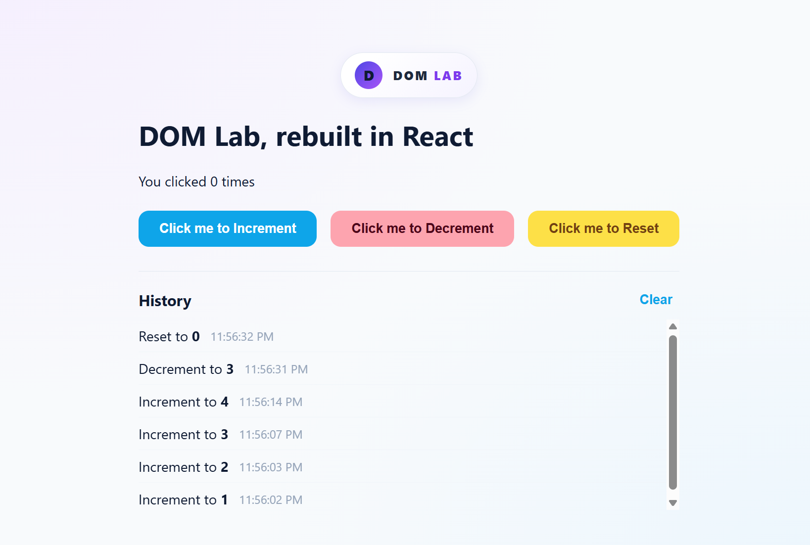
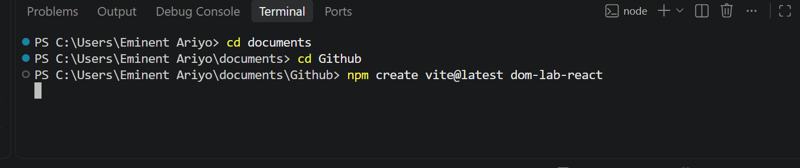
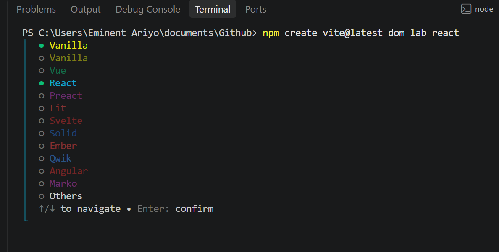
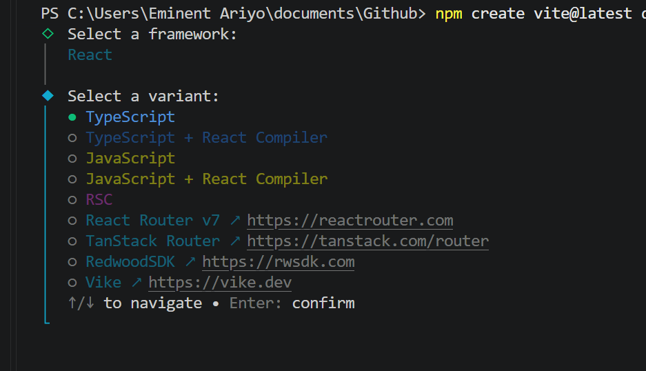
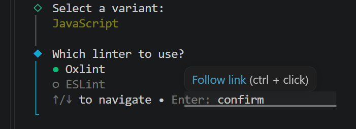

# dom-lab-react


## Project initialization

This project is a React application. The steps below describe a typical setup from creating the project through running it locally.

### 1. Create the project

Install [Node.js](https://nodejs.org/) first; npm is included with it. To scaffold a React project with Vite, run:

```bash
npm create vite@latest dom-lab-react -- --template react 
```








```bash
cd dom-lab-react
```


The scaffolding command creates the project files, including the package manifest (`package.json`), the application source, and the Vite configuration.

### 2. Install dependencies

From the project directory, run:

```bash
npm install
```

npm reads `package.json` and downloads the project’s dependencies into `node_modules`. It also creates or updates `package-lock.json` to record the resolved dependency versions. The lockfile should be kept with the project so installs can be reproduced.

### 3. Run the development server

```bash
npm run dev
```

Vite prints a local address in the terminal. Open that address in a browser to view the starter application. While the server is running, edits to the source are reflected in the browser.

### Current starting point

After these steps, the React/Vite starter is installed and running, ready for the application’s features to be added. `src/App.jsx` is the main component to edit, and `src/main.jsx` mounts the React application in the page. 


### Project structure

| File | What it does

| `src/main.jsx` | Entry point. Mounts the React app into the page. |
| `src/App.jsx` | The main component. Holds the state (`count` and `history`) and the `historyAction` function that every button uses. |
| `src/components/History.jsx` | Displays the click history as a table with Action, Count, and Time columns. Receives its data through props and has no state of its own. |
| `src/App.css` | Styling for the card, the buttons, and the history table. |
| `src/index.css` | Page-wide base styles (background, font). |

## How it works
- `useState` stores the current count and the history array.
- Each button calls `historyAction`, which updates the count and adds an entry
  (action, resulting count, time) to the front of the history.
- Props pass data down (`entries` to `History`) and functions down (`onClear`).
- The history shows the entries, time and action, also shows newest first, and can be cleared.

## What I added or improved
- Increment, Decrement, and Reset buttons
- Click history table with an Action column, newest first, capped at 10, with a Clear button
- Card layout, color-coded buttons, and keyboard focus styles
